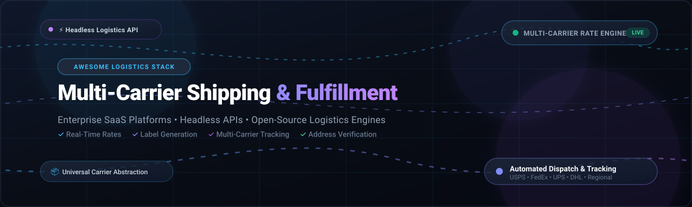

# 📦 Awesome Multi-Carrier Shipping & Fulfillment 🚚

  

  <b>A curated list of top Multi-Carrier Shipping and Fulfillment software, SaaS platforms, developer APIs, and open-source libraries for rate comparison, label generation, batch printing, multi-carrier tracking, address verification, and e-commerce warehouse fulfillment automation. 🌐✨</b>

---

## 📑 Table of Contents

- [🌐 Sector Overview & Market Dynamics](#-sector-overview--market-dynamics)
- [🟦 SaaS / Hosted Platforms](#-saas--hosted-platforms)
- [🟩 Open-Source Software & Developer Libraries](#-open-source-software--developer-libraries)
- [📊 Feature Comparison Matrix](#-feature-comparison-matrix)
- [💡 Key Selection Criteria](#-key-selection-criteria)
- [💖 Support](#-support)
- [📈 Star History](#-star-history)
- [🤝 Contributing](#-contributing)
- [📄 License](#-license)

---

## 🌐 Sector Overview & Market Dynamics 📊

The global multi-carrier shipping and parcel management software market is estimated at **$2.4B to $4.2B**, projected to surpass **$10B+ by 2030** propelled by global cross-border e-commerce, omnichannel fulfillment, and automated rate shopping. 📈

The market structure is **moderately fragmented yet converging toward oligopoly** at the enterprise scale: legacy logistics behemoths (e.g., Descartes, Auctane/Stamps.com) and modern API-first unicorns (e.g., EasyPost, Shippo) capture the lion's share of North American and European shipping volumes, while regional compliance requirements, local courier networks, and emerging open-source stacks sustain vibrant niche ecosystems worldwide. 🌍

---

## 🟦 SaaS / Hosted Platforms ☁️

The following hosted commercial platforms provide managed carrier integrations, rate calculation, pre-negotiated postage discounts, automated label generation, and tracking APIs. Ranked in descending order by enterprise valuation / market capitalization: 🏆

| Platform | Valuation / Company Size | Pricing (Starting Paid Tier) | Free Tier & Free Trial Limits | Key Highlights & Target Audience |
| :--- | :--- | :--- | :--- | :--- |
| **[Descartes ShipRush](https://shiprush.com/)** | **~$8.1B** *(Descartes Systems Group NASDAQ: DSGX market cap)* | **$9.95/month** *(Express plan, scales to $29.95/mo Speedy & $99.95/mo Warehouse)* | **15-day free trial** *(full feature access across standard plans)* | Multi-carrier shipping software built for SMBs, e-commerce stores, and mid-sized warehouses needing direct desktop/cloud integrations with major carriers and accounting systems. 🏬 |
| **[ShipStation](https://www.shipstation.com/)** | **~$6.6B** *(Auctane / Stamps.com take-private acquisition valuation)* | **$14.99/month** *(Starter plan, up to 50 shipments/month, 3 users)* | **30-day free trial** *(unlimited features and test batches, postage costs billed separately)* | Industry-leading web-based order fulfillment platform connecting 100+ marketplaces, shopping carts, and global carriers with batch label generation and automation rules. 🏷️ |
| **[EasyPost](https://www.easypost.com/)** | **~$1.5B** *(Peak venture valuation)* | **$20.00/month** *(BYOCA plan: Bring-Your-Own-Carrier at $0.08/label)* | **Free forever plan: Up to 3,000 labels/month** *(using EasyPost Wallet pre-negotiated carriers; $0.08/label overage)* | Modern, developer-first shipping API with carrier abstraction, real-time rate comparison, tracking webhooks, and domestic/international address verification. ⚡ |
| **[Shippo](https://goshippo.com/)** | **~$1.0B** *(Series E unicorn valuation)* | **$19.00/month** *(Professional plan, custom branding & automations)* | **Free forever plan: Up to 30 labels/month** *(using Shippo carrier accounts; 1 user login; $0.05-$0.07/label when linking own carrier accounts)* | E-commerce shipping dashboard and unified REST API connecting Shopify, WooCommerce, USPS, FedEx, UPS, and DHL for rate shopping and instant label printing. 🛒 |
| **[Sendcloud](https://www.sendcloud.com/)** | **~$750M - $1.0B** *(Backed by $177M Series C led by SoftBank; ~$100M ARR scale)* | **€28.00/month** *(Lite plan: 400 labels/mo base allowance)* | **Free forever plan: Pay-per-label only** *(unlimited regular parcel volume strictly on Sendcloud carrier rates; max 50 unstamped letters; own carrier contracts excluded)* | Europe's all-in-one shipping platform offering localized carrier connections, branded tracking pages, automated returns portals, and checkout pick-up point selectors. 🇪🇺 |
| **[ShipEngine](https://www.shipengine.com/)** | **Part of Auctane ($6.6B)** | **$75.00/month** *(Advanced 1K plan: includes 1,000 labels/mo at $0.075 overage)* | **Free plan ($0/mo platform fee)** *(pay only label postage on ShipEngine carrier accounts; 30-day sandbox trial without credit card for API testing)* | High-performance multi-carrier shipping API for platforms, 3PLs, and large-scale merchants requiring deep programmatic rating, tracking webhooks, and validation. 🚀 |

---

## 🟩 Open-Source Software & Developer Libraries 🛠️

Self-hosted, community-driven, and developer-centric multi-carrier shipping solutions, headless logistics APIs, and carrier abstraction libraries. Sorted in descending order by GitHub stargazers: ⭐

### 1. [Karrio](https://github.com/karrioapi/karrio)  📦
* **Stack:** Python, Django, Next.js, React, GraphQL, Docker 🐍
* **License:** LGPL-3.0 (Core Engine & SDK) / Commercial (EE modules) 📄
* **Description:** The leading open-source, headless multi-carrier shipping platform and logistics API. Karrio provides a unified GraphQL & REST API layer to connect with dozens of worldwide couriers (UPS, FedEx, DHL, USPS, Canada Post, Purolator, Australia Post, etc.). Includes a modern web dashboard for tracking shipments, booking pickups, printing commercial invoices/labels, and managing carrier accounts. 🌐

### 2. [ActiveShipping](https://github.com/Shopify/active_shipping)  💎
* **Stack:** Ruby 💎
* **License:** MIT 📄
* **Description:** Extracted from Shopify's production core, ActiveShipping is the battle-tested multi-carrier shipping abstraction library for Ruby. It exposes a normalized interface for calculating shipping rates, tracking parcel milestones, and verifying destination addresses across USPS, UPS, FedEx, Canada Post, and Australia Post. 🛍️

### 3. [ERPNext Shipping](https://github.com/frappe/erpnext-shipping)  🏭
* **Stack:** Python, Frappe Framework, ERPNext 🐍
* **License:** GPL-3.0 📄
* **Description:** The official multi-carrier shipping integration app for ERPNext. Enables enterprise rate shopping across multiple aggregators and carriers (including Sendcloud and LetMeShip), one-click shipment creation from sales orders, automated label printing directly on packing slips, and synchronized live parcel tracking. 📦

### 4. [DotNetShipping](https://github.com/kylewest/DotNetShipping)  🔷
* **Stack:** C#, .NET 💻
* **License:** MIT 📄
* **Description:** A popular .NET multi-carrier rate calculation library. DotNetShipping wraps carrier web services for UPS, FedEx, and USPS into an intuitive, unified object model, enabling .NET e-commerce applications to fetch real-time carrier rates concurrently with automatic metric/imperial unit conversion. ⚡

### 5. [ShippingRates](https://github.com/AlexeyBusygin/ShippingRates)  🚀
* **Stack:** C#, .NET Standard 💻
* **License:** MIT 📄
* **Description:** A modern, cross-platform .NET library that retrieves shipping rates from multiple carriers (UPS, FedEx, USPS, and DHL). Uses an extensible `RateManager` architecture that queries providers in parallel and returns structured quotes with error handling and service breakdown. ⏱️

### 6. [python-ship](https://github.com/benweatherman/python-ship)  🐍
* **Stack:** Python 🐍
* **License:** MIT 📄
* **Description:** A Pythonic multi-carrier interface unifying access to common parcel carrier APIs (UPS, USPS, and FedEx). Designed for clean rate shopping, address validation, and shipment tracking without boilerplate SOAP/XML handling. ✨

### 7. [cardmagic/shipping](https://github.com/cardmagic/shipping)  🚚
* **Stack:** Ruby 💎
* **License:** MIT 📄
* **Description:** An easy-to-use Ruby shipping gem for calculating shipping rates, tracking orders, and handling multi-package delivery configurations across major national and international logistics carriers. 📬

### 8. [dzship](https://github.com/DZBuild-com/dzship)  📍
* **Stack:** TypeScript, Node.js 🟩
* **License:** MIT 📄
* **Description:** An open-source multi-carrier shipping API connecting 90+ regional parcel couriers (Yalidine, ZR Express, Maystro, NOEST, Ecotrack network). Features unified COD (cash on delivery) order creation, label rendering, commune dataset mapping, and tracking status normalization. 🌍

### 9. [Roulier](https://github.com/akretion/roulier)  🇫🇷
* **Stack:** Python 🐍
* **License:** AGPL-3.0 📄
* **Description:** A specialized Python library designed to communicate directly with French and European carrier APIs (La Poste, Colissimo, DPD, Chronopost, GLS) using merchant API credentials to generate parcel labels, track statuses, and request pickups. 🏷️

### 10. [pdt256/shipping](https://github.com/pdt256/shipping)  🐘
* **Stack:** PHP 🐘
* **License:** MIT 📄
* **Description:** A modular PHP shipping rate aggregator for USPS, UPS, and FedEx. Standardizes rate requests, parcel dimensions, and origin/destination coordinates into a clean object-oriented PHP architecture. 🔧

### 11. [ParcelBridge](https://github.com/salines/parcelbridge)  🏢
* **Stack:** PHP, CakePHP 5, MariaDB 🐘
* **License:** MIT 📄
* **Description:** An open-source backend starter application and warehouse workflow system designed for package forwarding services, intake scanning, customs invoice review, ship request management, and outbound dispatch operations. 📋

---

## 📊 Feature Comparison Matrix

| Solution | Deployment | License | Multi-Carrier Rate Comparison | Shipping Label Generation | Real-Time Tracking | Address Verification | Self-Hosted | Primary Use Case |
| :--- | :--- | :--- | :---: | :---: | :---: | :---: | :---: | :--- |
| **Descartes ShipRush** | Cloud / Desktop | Proprietary | ✅ | ✅ | ✅ | ✅ | ❌ | Small-to-midsize warehouse shipping 🏬 |
| **ShipStation** | Cloud SaaS | Proprietary | ✅ | ✅ | ✅ | ✅ | ❌ | High-volume multi-channel e-commerce 🏷️ |
| **EasyPost** | Cloud API | Proprietary | ✅ | ✅ | ✅ | ✅ | ❌ | Developer-first shipping infrastructure ⚡ |
| **Shippo** | Cloud SaaS / API | Proprietary | ✅ | ✅ | ✅ | ✅ | ❌ | Small business & direct storefronts 🛒 |
| **Sendcloud** | Cloud SaaS | Proprietary | ✅ | ✅ | ✅ | ✅ | ❌ | European cross-border shipping 🇪🇺 |
| **ShipEngine** | Cloud API | Proprietary | ✅ | ✅ | ✅ | ✅ | ❌ | Enterprise logistics & 3PL platforms 🚀 |
| **Karrio** | Self-Hosted / Cloud | LGPL-3.0 / Commercial | ✅ | ✅ | ✅ | ✅ (Enterprise) | ✅ | Open-source API-first shipping platform 📦 |
| **ActiveShipping** | Ruby Gem | MIT | ✅ | ❌ | ✅ | ✅ | ✅ | Ruby on Rails e-commerce apps 💎 |
| **ERPNext Shipping**| Frappe App | GPL-3.0 | ✅ (Via providers) | ✅ | ✅ | ❌ | ✅ | Integrated ERPNext warehouse logistics 🏭 |
| **DotNetShipping** | .NET NuGet | MIT | ✅ | ❌ | ❌ | ❌ | ✅ | C# / .NET rate shopping engine 💻 |
| **ShippingRates** | .NET NuGet | MIT | ✅ | ❌ | ❌ | ❌ | ✅ | Modern C# multi-carrier quotes ⏱️ |
| **python-ship** | Python Package | MIT | ✅ | ❌ | ✅ | ✅ | ✅ | Python automation & rate check scripts 🐍 |
| **cardmagic/shipping**| Ruby Gem | MIT | ✅ | ❌ | ✅ | ❌ | ✅ | Ruby rate & tracking calculations 🚚 |
| **dzship** | Node.js / NPM | MIT | ✅ | ✅ | ✅ | ❌ | ✅ | North African regional carrier network 📍 |
| **Roulier** | Python Package | AGPL-3.0 | ❌ | ✅ | ✅ | ❌ | ✅ | Direct French carrier API integration 🇫🇷 |
| **pdt256/shipping** | PHP Composer | MIT | ✅ | ❌ | ❌ | ❌ | ✅ | PHP rate calculation & shopping 🐘 |
| **ParcelBridge** | Self-Hosted Web App | MIT | ❌ | ❌ | ✅ (Workflow) | ❌ | ✅ | Package forwarding & warehouse intake 🏢 |

---

## 💡 Key Selection Criteria 🔍

When selecting a multi-carrier shipping solution for your e-commerce stack or logistics pipeline, evaluate the following factors:

1. **Carrier Coverage & Regional Reach:** Ensure native compatibility with primary national carriers (USPS, UPS, FedEx, DHL, Royal Mail, DPD, Colissimo) and regional last-mile delivery providers. 🚚
2. **Bring Your Own Carrier (BYOC) vs. Pre-Negotiated Rates:** Hosted platforms often charge a surcharge ($0.05–$0.08/label or higher monthly subscriptions) to link existing negotiated courier contracts. Self-hosted options like **Karrio** permit direct merchant account usage without per-label toll fees. 💰
3. **API-First vs. Turnkey Dashboard:** Businesses with custom order management systems (OMS) or ERPs benefit from headless APIs (Karrio, EasyPost, ShipEngine), whereas merchants operating on Shopify/WooCommerce often prioritize visual dashboards (ShipStation, Shippo, Sendcloud). 🖥️
4. **Data Privacy & Self-Hosting:** Regulated industries, healthcare fulfillment, or high-volume merchants seeking zero vendor lock-in can deploy self-hosted stacks (Docker / Kubernetes) with full database ownership. 🔒

---

## 💖 Support ☕

If you found this list helpful, please consider supporting the project:

- ⭐ **Star this repository** to help others discover it!
- 🍴 **Fork and contribute** new carriers, APIs, or open-source software.
- 📢 **Share with fellow developers, e-commerce builders, and logistics engineers.**
- ☕ **Buy me a coffee / Sponsor:** Support ongoing maintenance via the [GitHub Sponsors Dashboard](https://github.com/sponsors/ishandutta2007) — every bit of support is greatly appreciated! ❤️

---

## 📈 Star History

---

## 🤝 Contributing 🤝

Contributions are welcomed! If you know of an active open-source multi-carrier shipping tool, carrier SDK, or fulfillment automation framework:

1. 🍴 Fork this repository.
2. 📝 Add your project under the appropriate category in alphabetical or star-ranked order.
3. 🔗 Include the repository URL, tech stack, license, and Stars_Count badge.
4. 🚀 Submit a pull request with a descriptive title and release verification.

---

## 📄 License 📜

This repository is curated and maintained under the [Creative Commons Zero v1.0 Universal](LICENSE) (CC0 1.0) Public Domain Dedication.
